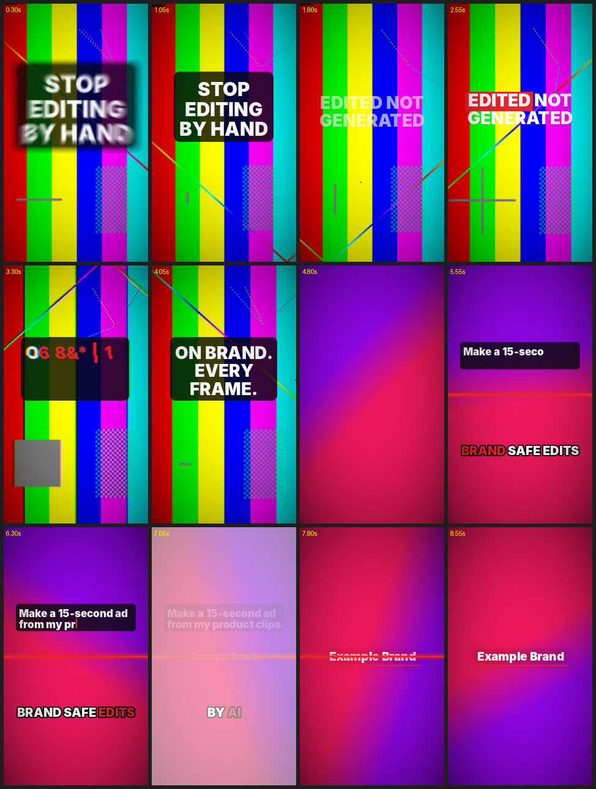

# cutwarden

**Brand-safe video editing for AI agents, over MCP.** The AI edits; it never generates pixels.

Give Claude, ChatGPT, Gemini (or any MCP client) a timeline, a library of motion presets, and your brand kit.
It cuts footage, adds kinetic type, whips, flashes, captions and logo reveals, looks at its own frames,
fixes problems, and renders an MP4. No browser, no After Effects, no video-generation model.


`docs/demo_540p.mp4` was made entirely by the tool calls in `examples/demo.py` (synthetic footage).

## Why this design

- **Edited, not generated.** Footage is never altered by a model. The AI only decides *what goes where, when*.
- **Brand safety is enforced by the tools, not by the prompt.** Only brand color names and font roles are accepted.
  `color="#ff00ff"` is rejected with a message listing the allowed names. Safe zones, contrast and reading speed are checked.
- **The AI can see.** `render_frame` and `render_contact_sheet` return images, so the model reviews and corrects its work.
- **Deterministic.** Same project + same time = same pixels. Nothing depends on a clock or a browser.
- **Human-readable project.** The timeline is plain JSON with a revision counter, so stale edits are refused and `undo` works.

## Install

Requires Python 3.10+ and FFmpeg on your PATH.

```bash
pip install -e .            # from this folder
pip install -e ".[transcribe]"   # optional: word timestamps via faster-whisper
```

## Connect it

**Claude Code / Claude Desktop / Cursor (local, stdio)**
```bash
claude mcp add cutwarden -e CUTWARDEN_BRAND=/path/to/your/brand.json -- cutwarden-mcp
```

**ChatGPT / Gemini / anything remote (HTTP)**
```bash
cutwarden-mcp --http --port 8100        # serves http://127.0.0.1:8100/mcp
```
Expose it with a tunnel or host it, then add the URL as a custom MCP connector in the client.
Remote clients cannot read your local disk, so put footage where the server can reach it
(same machine, a mounted volume, or add an upload/download tool for your setup).

Environment: `CUTWARDEN_WORKDIR` (projects and renders, default `~/cutwarden-projects`), `CUTWARDEN_BRAND` (default brand kit).

No agent needed for rendering an existing project:
```bash
cutwarden frame project.json 2.4 frame.png
cutwarden render project.json out.mp4 --workers 4
python examples/demo.py          # builds and renders the demo
```

## Importing

Everything the model needs can come in through tools, so remote clients (ChatGPT, Gemini) work without disk access:

- `import_media(source)`: video, audio or image from an `http(s)` URL (or a local path on stdio). It is copied into `WORKDIR/assets`, probed, and the stored `path` is what you pass to `clip`, `music`, `voice` and `image`. Identical files are de-duplicated.
- `import_media_base64(filename, data_base64)`: small files up to 25 MB, sent inline.
- `import_captions(source, offset)`: SRT or WebVTT (text, path or URL) becomes `[[word, start, end], ...]` for `word_captions`.
- `import_brand(name, colors, fonts, logo)`: builds and validates a brand kit from hex colors, `.otf`/`.ttf` files and a PNG logo.
- `import_project(name, timeline)`: recreates a project from `get_timeline` output; every layer is re-validated.
- CLI: `cutwarden import clip.mp4`, `cutwarden import subs.srt --captions`.

Safety: URL imports refuse private/loopback addresses (including via redirects) and stop at `CUTWARDEN_MAX_MB` (default 1000).
In `--http` mode local-path imports are off by default so a remote client cannot copy files off your server
(`CUTWARDEN_ALLOW_LOCAL=1` to override; `CUTWARDEN_ALLOW_PRIVATE_URLS=1` to fetch from your LAN).

## Exporting

Everything lands in `WORKDIR/exports/<project>/`.

- `export_otio`: OpenTimelineIO, so a human can finish the edit in Resolve, Premiere, Final Cut or Kdenlive through OTIO adapters.
  Footage, overlays and audio are real clips on tracks (source in/out preserved); text, logo and effects are placeholder clips that
  carry their full cutwarden parameters in metadata. Verified by loading the file with the real `opentimelineio` library.
- `export_edl`: CMX 3600 cut list of the footage and audio source clips.
- `export_captions`: SRT or WebVTT from `word_captions` (and titles with `include_titles`).
- `export_video`: `mp4` (H.264), `mov_prores` (ProRes 422 HQ), `webm` (VP9), `gif` (palette-optimized), `mp3`, `wav`.
- `export_poster`: one frame as PNG.
- `export_bundle` / `import_bundle`: a portable zip (project, media, brand kit, relative paths) that reopens on any machine.
- `download_chunk(path, index)`: fetch any exported or rendered file as base64 chunks with a final sha256, for remote clients that cannot read
  the server's disk. Restricted to `exports/` and `renders/`.

## Brand kit

`brand.json` (see `brands/example/`):
```json
{
  "name": "Acme",
  "colors": {"bg": "#0A0A0C", "fg": "#FFFFFF", "accent": "#E5262D"},
  "fonts": {"display": "fonts/Inter-Black.otf", "body": "fonts/Inter-Bold.otf"},
  "logo": "logo.png",
  "safe": {"top": 0.12, "bottom": 0.22, "left": 0.06, "right": 0.10},
  "loudness_target": -14,
  "allow_custom_colors": false
}
```
`bg`, `fg`, `accent` and a `display` font are required. Add any other named colors you like.

## Tools (36)

| Group | Tools |
|---|---|
| Discover | `get_brand`, `list_presets` |
| Import | `import_media` (URL or path), `import_media_base64`, `upload_begin` / `upload_chunk` / `upload_finish` (push a file in pieces), `list_assets`, `import_captions` (SRT/VTT), `import_brand`, `import_project` |
| Project | `create_project`, `list_projects`, `get_timeline`, `add_layer`, `update_layer`, `remove_layer`, `undo` |
| Understand footage | `probe_media`, `source_contact_sheet`, `detect_scenes`, `detect_silence`, `transcribe_audio` |
| Look and check | `render_frame`, `render_contact_sheet`, `validate_project` |
| Output | `render_video`, `qa_video` |
| Export | `export_otio`, `export_edl`, `export_captions`, `export_video`, `export_poster`, `export_bundle`, `import_bundle`, `download_chunk` |

Every parameter is validated against the preset. Errors say what is wrong and what is allowed
(unknown param names list the valid ones; stale revisions say to refresh).

## Presets

GIFs and animated WebP play in sync with the timeline (looping, with speed control), in both `image` and `overlay`.

| Kind | Presets |
|---|---|
| Text | `slam_in`, `fade_up`, `typewriter`, `glitch_letters`, `highlight_box`, `word_captions` |
| Logo | `logo_reveal` (uses the brand logo, or a wordmark if none) |
| Effects | `whip`, `flash`, `shake`, `zoom_punch`, `vignette`, `rgb_split`, `scanline`, `color_grade`, `film_grain`, `blur_pulse`, `pixelate`, `letterbox`, `bloom`, `light_leak` |
| Overlay | `overlay`: image, transparent PNG or animated GIF placed at x/y/width, with pop/fade/slide entrances, rotation, opacity, drop shadow, loop and speed |
| Footage | `clip` (trim, cover/contain, slow push-in, own audio), `image` (still or animated GIF/WebP, full frame) |
| Audio | `music` (auto-ducks under voice and clip audio, `duck` 0-1, default 0.6), `voice` (mixed and loudness-normalized to the brand target) |

Effects act on everything beneath them (by `z`), like adjustment layers. Center a `whip` on a cut:
`start = cut_time - duration / 2`. Add a preset by writing one function with the `@preset` decorator in `cutwarden/presets.py`.

## Quality gates

`validate_project` flags: missing files, text off canvas or outside the safe zone, low contrast, text too fast to read,
overlapping text, clips running past their source, nothing on screen in the first 0.5s, platform length/aspect limits.
`qa_video` checks the rendered file: resolution, integrated loudness, true peak, black frames.

## Performance (measured, honest)

Compositing runs in Python with Pillow/NumPy; FFmpeg does decode/encode. On one CPU core the demo composes at roughly
35 ms/frame at 540x960 and 135 ms/frame at 1080x1920. `render_video` splits the timeline across CPU cores
(one process per chunk), so a 30 s 1080p video is about 2 minutes on one core and scales down with core count.
Use `scale=0.5` for previews. Not yet benchmarked on multi-core hardware.

## Status and limits

Early (v0.5). Tested: the demo project end to end, music ducking (`tests/export_test.py` (OTIO read back by the real library, EDL, SRT/VTT, bundle round trip, formats, chunked download), `tests/gif_effects_test.py` (GIF frame timing, overlay, every new effect, chunked upload), `tests/import_test.py` (media, URL, base64, SSRF guard, SRT/VTT, brand, project), `tests/duck_test.py`: music drops about 7 dB under voice and recovers), stdio and HTTP MCP transports, parallel chunk render, error messages.
**Not yet tested against real ChatGPT or Gemini clients**, only raw JSON-RPC.

Known gaps / roadmap:
- Per-word kinetic text on speech, and more presets (3D elements, stacked repeating text, shape bursts)
- Hardware-accelerated compositing (Skia / GPU) if Pillow becomes the bottleneck
- Multiple video tracks with blend modes, color grading, masks
- Async renders with progress for very long videos
- Automated tests beyond `tests/rpc_smoke.py`

## License

MIT. Example fonts (Inter) are SIL OFL; replace with your brand fonts.

## Host it for free (Cloudflare + Hugging Face)

The site and a token-checking gateway run on the Cloudflare Workers free plan. The renderer (Python + FFmpeg) runs in a free Hugging Face Space. Clients use `https://cutwarden.<subdomain>.workers.dev/mcp?key=<token>`.

**1. Backend (Hugging Face Space)**
1. Create a Space at huggingface.co/new-space: SDK **Docker**, hardware **CPU basic (free)**, name `cutwarden`.
2. In the Space > Settings > Variables and secrets, add a secret `CUTWARDEN_GATEWAY_SECRET` (long random string).
3. Create a write token at huggingface.co/settings/tokens, then from this repo run:
   `HF_TOKEN=hf_xxx scripts/deploy_space.sh <hf-user>/cutwarden`
4. The Space builds the Dockerfile. When it shows "Running", `https://<hf-user>-cutwarden.hf.space/health` answers `cutwarden ok`.

**2. Gateway and site (Cloudflare Workers free plan)**
1. Edit `BACKEND_URL` in `wrangler.jsonc` to `https://<hf-user>-cutwarden.hf.space`.
2. Run:
   ```bash
   npm install
   npx wrangler login
   npx wrangler secret put CUTWARDEN_TOKEN             # what clients send
   npx wrangler secret put CUTWARDEN_GATEWAY_SECRET    # same value as in the Space
   npx wrangler deploy
   ```
3. Add `https://cutwarden.<subdomain>.workers.dev/mcp?key=<CUTWARDEN_TOKEN>` as a custom MCP connector.

Limits to expect: the Space's disk is wiped on every restart, so projects, imported media and renders do not persist (export as you go). Free Spaces sleep after a stretch of inactivity; a Worker cron ping every 12 hours helps, and the gateway answers 503 "waking up" while the Space restarts. Renders on 2 free CPUs are slower than on a paid instance. For GitHub auto-deploy add repo secrets `CLOUDFLARE_API_TOKEN`, `CLOUDFLARE_ACCOUNT_ID`, `HF_TOKEN` and the repo variable `HF_SPACE`.

Self-hosting without Cloudflare: `docker build -t cutwarden . && docker run -p 7860:7860 cutwarden`, then put your own auth in front.
